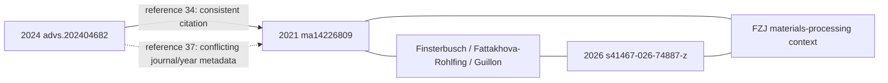

# Bounded experimental-literature pilot

`python -m rhombus.literature.harvest` discovers bibliographic candidates through
Europe PMC, Crossref and OpenAlex, deduplicates normalized DOIs, freezes a
source acquisition list, and retrieves eligible open-access JATS through the
Europe PMC REST service. It is an experimental intake pipeline, not a qualified
production model or an independent scientific benchmark.

## Reproduce and inspect

Run from the existing `/workspace/Rhombus` checkout with its Python 3.11
Fast CI virtual environment active. No API credential or paid service is used.

```bash
python -m pytest -q tests/test_literature_harvest.py
python -m rhombus.literature.harvest \
  --output-dir /tmp/rhombus-discovery-new \
  --discovery-target 1000 --acquisition-limit 100
```

Output directories must be new. This first command records discovery and an
acquisition plan; without a current policy evidence record it does not launch
bulk full-text requests. This is a reproducibility requirement, not an approval
prompt. Inspect the current official documentation, copyright guidance, and
API-host robots policy; retain their local bytes and hashes. A policy JSON binds:

- `provider`: `europepmc`;
- `documentation_url`: `https://europepmc.org/RestfulWebService`;
- `documentation_file`, `documentation_sha256`: retained documentation;
- `verified_utc`: timezone-aware inspection time, no older than seven days;
- `free_fulltext_access_confirmed`: true only after inspecting current terms;
- `max_publications`: internal bound, at most 100;
- `requests_per_second`: at most 0.1;
- `terms_evidence_excerpt`: actual observations, including uncertainties;
- optional `supporting_documents`: objects with `file` and `sha256`.

The validator checks record integrity, freshness and limits. It does not decide
legal terms from a boolean. The inspected 2026-10-20 official copyright page
explicitly permits automated retrieval through REST/OAI/SOAP/bulk services while
prohibiting website crawling. The API host's wildcard robots policy specifies
10 seconds between requests. No numerical provider API quota was stated in the
inspected documentation; 100 is our processing limit, not a provider allowance.
Document-specific licenses remain attached to each authenticated article.

Reuse discovery, rather than repeating valid downloads:

```bash
python -m rhombus.literature.harvest \
  --output-dir /tmp/rhombus-acquisition-new \
  --discovery-file /tmp/rhombus-discovery-new/discovery.json \
  --quota-evidence /path/to/inspected-policy.json --acquisition-limit 100
python -m rhombus.literature.harvest \
  --output-dir /tmp/rhombus-parser-replay-new \
  --replay-acquisition-dir /tmp/rhombus-acquisition-new
```

Replay verifies every retained response against its original retrieval hash and
makes no network requests. Replay is not current source authentication. Raw
full text stays in `raw-local-only` outside the repository; do not add it to Git
without document-specific redistribution authorization. The pilot preserves
bounded JSON reports and row-level derived evidence instead.

## Scientific admission and limitations

Search matches, review screening and oxide-related title prioritization are
metadata heuristics. Discovered DOI count is not relevant original-study count,
independent author-study count, material count or specimen count. Titles never
certify O_ONLY chemistry. A document must match front-matter DOI/PMCID, carry a
document-specific license and identify itself as a research article.

Generic tables retain caption, row and column text and the source hash. Only a
narrow flat schema with explicit sample, nominal formula, route, process
conditions, measured temperature, observable, units and uncertainty is parsed
numerically. Missing context produces EXPLORATORY rows. Strict source-context
qualification requires explicit exact-25 C TOTAL values, lithium/O_ONLY nominal
composition, and complete supported processing context. Sulfur-containing rows
and contradictory condition identities are rejected. Secondary reference-table
markers, repeated identities, spanning columns, scaled/ambiguous units,
inequalities and unspecified room temperature cannot silently qualify.

Existing 2018/2020 source-exact conductivity/process parsers are reused. A new
original-source adapter extracts the seven reported HP/SPS cells in DOI
`10.1002/smll.202506257` (PMC12530038), binding each to Table 3 and its exact
method/temperature column. Units convert mS/cm to S/cm. Pre-press pressure
10 MPa is distinct from processing pressure 25 MPa; 5-minute sintering is
separate from the 850 C, 4-hour post-treatment. The empty SPS 1100 C cell remains
missing. A 25 C water-density statement is not an EIS measurement temperature.
All seven remain EXPLORATORY: conductivity is reported at unspecified RT and
TOTAL/BULK identity is not explicitly qualified.

These parsers do not cover all table layouts, free-text formula/process joins,
PDFs, scanned figures, supplementary tables or uncertainty conventions. Missing
values are never invented. Nominal powder formula is not final pellet chemistry.
DOI is not a guarantee of independent authors, specimens or material families.

The 2026-10-20 run and parser replay are development data. Newly viewed labels
cannot become a blind heldout cohort. No model fitting, benchmark scoring or
OBELiX TEST access occurs here. A future evaluation requires a protocol and
whole connected DOI/composition/specimen/process embargo frozen before label
exposure, plus the existing frozen baselines. This pilot does not claim improved
MAE, ranking, top-1 utility or calibration. P0-01/02/03 stay BLOCKED and production
stays disabled. Checkpoint 0195 is intentionally not consumed by this intake
work while new exact-25 C TOTAL scientific admission remains unresolved.

## Actual pilot result, 2026-10-20

The [bounded evidence report](../data/development/literature_pilot_20261020_v1.json)
retains retrieval hashes, exact failures and derived measurement rows. Discovery
returned **1,000 unique DOI metadata candidates**, including unqualified or
irrelevant hits; it did not prove 1,000 relevant original experimental studies.
The frozen, title-prioritized OA cohort contained **68** publications. All 68
full-text responses were obtained; **63** passed DOI/PMCID, document-license
presence and article-type checks. Two article types were not authenticated as
original research, and three RSC XML sources lacked a document-specific license.
These current intake rejections do not invalidate historical source evidence.

Final local parser replay extracted **12 exploratory manufacturing-condition
rows**: seven new HP/SPS rows from the 2025 Small paper and five previously known
2020 Nb-LLZO rows. **Strict-qualified rows: zero.** It also retained 179 raw table
row candidates. Among all 68 attempts, 47 had no conductivity table candidates,
14 had unsupported extraction schemas, five failed article/rights gates, and two
produced measurement rows. “No table candidates” is a parser coverage outcome,
not proof that an article has no experimental conductivity data.

Discovery used 11 HTTP requests in 26.23 seconds; acquisition used 68 requests
in 672.39 seconds, with a 10-second interval. Final replay used zero network
requests. No paid API calls or additional monetary expenditure were introduced;
CPU time and peak memory were not instrumented. Raw articles remain local.
These are development observations, not independent predictive validation.

The separate source-continuity repair is already on PR #364 at
`cbf37a0d0a93fc2d7ab462d57205e6d360692471`; its complete 0194 workflow
[39378676845](https://github.com/wt2018mask/Rhombus/actions/runs/39378676845)
succeeded. On that exact commit 53/59 latest checks succeeded; five unrelated
SI ZIP/crystal-comparison runs and one OSTI manuscript acquisition failed.
Their failed steps are identified, but full log access is denied in this
cloud environment. Their exact causes remain unresolved; no automatic reruns
or source-validation relaxations were used. Canonical integration remains
blocked and neither existing PR was merged.

## Offline yield review and shared-source repair, 2026-10-20

The [source-by-source review](../data/development/literature_yield_review_20261020_v1.json)
replays the same 68 retained responses and records every DOI, original response
hash, initial loss, review category and inspection evidence. No new paper search
or broad full-text acquisition was performed. These are prioritization judgments
for the current oxide-manufacturing comparison, not declarations that other
studies are scientifically irrelevant.

| Initial loss | Reviewed causes |
| --- | --- |
| 47 without table candidates | 30 outside the target comparison, 5 supplementary-dependent, 6 prose, 2 parser-coverage gaps, 4 scientifically incomparable |
| 14 unsupported schemas | 4 parser gaps, 5 outside the target comparison, 4 scientifically incomparable, 1 supplementary-dependent |
| 5 source-gate rejections | 3 missing document-specific licenses, 2 non-original-study article types |

An additional scoped prose parser recovers six conditions in original DOI
`10.1038/s41467-025-58108-7`, PMC11972412. It binds numerical values to exact
source clauses and paragraph hashes. The 400 C/2 h, 600 C/unspecified hold,
600 C/15 h, conventional reference, pre-densification and post-densification
conditions remain distinct. The unspecified hold is not filled from neighboring
text. The separate 375 MPa hot-press experiment is not attached to these values.

The pre/post-densification pair has the same stated 500 C/2 h crystallization
condition but reported conductivities of 1.8e-4 and 4.2e-7 S/cm. Temperature/time
alone cannot distinguish the two processing orders. This is one author-reported,
previously public comparison; its EIS temperature is not explicitly bound to
that pair and TOTAL/BULK identity remains unresolved. It is not a new exact-25 C
TOTAL benchmark, a causal qualification or evidence of model superiority.

The existing 0190 Sn-garnet parser is reused for eight keyed DS/MS records.
These are already-known 25 C TOTAL source labels, not eight new experiments.
Intake now distinguishes an authenticated article from a failed measurement
parser: a binding failure blocks the labels while preserving article identity.

| Yield | Before | After |
| --- | ---: | ---: |
| Exploratory rows | 12 | 26 |
| DOI groups with extracted rows | 2 | 4 |
| Rows with numeric temperature and hold time | 12 | 17 |
| New strict-qualified DOI groups | 0 | 0 |
| Strict usable manufacturing comparisons | 0 | 0 |

One newly recovered exploratory processing-order comparison is available for
parser/feature development. No model was fitted and exposed labels were not
claimed as an independent evaluation. OBELiX TEST 121 remains unread; P0-01/02/03
remain BLOCKED; scientific GO and production remain OFF. Checkpoint 0195 remains
reserved for substantive qualified scientific progress.

The highest-value supplementary lead is Table 5 of original DOI
`10.1038/s41467-026-74887-z`, PMC13490533, whose own text explicitly reports
25 C TOTAL conductivity for conventional/FAST-SPS samples. After the offline
review, one bounded request for the Europe PMC supplement archive timed out.
A request for its individually linked Supplementary Information PDF was blocked
at the environment proxy for `static-content.springer-cdn.com`. No supplement
bytes were received or source-qualified. The article's CC BY 4.0 notice and
exact linked filename were inspected; no article redistribution was introduced.

The six older source CI failures were all independently confirmed as OSTI 429
in original logs. PR #364 at `03c1bd5b1ba37284d73577c8fd58e4382b0d4251`
passed **59/59 exact-head checks**, including 0153/0156/0162/0163/0164/0165.
The successful 0153 and 0163 logs retained the original manuscript digest; those
runs did not encounter 429. The new 429 handling was exercised by regression
tests, not by manufacturing a rate-limit incident. Neither PR nor main was
merged. See [source recovery](SOURCE_RECOVERY.md) for the repair contract.

## Supplementary Table 5 qualification, 2026-10-20

The [new source and scientific receipt](../data/development/supplementary_table5_74887_20261020_v1.json)
authenticates Yao et al., *Elimination of detrimental grain boundary segregation
in garnets*, Nature Communications, DOI `10.1038/s41467-026-74887-z`,
PMC13490533. Article-specific rights are CC BY 4.0. The retained
[derived cell-coordinate extract](../data/development/table5_74887_bbox_20261020_v1.xml)
is attributed to that source. Raw PDF/ZIP files remain local-only.

The official Europe PMC REST supplementary archive returned HTTP 200 over the
inherited proxy: **51,596,476 bytes**, SHA-256
`9d0965de5b45ae0185046a855fb3774596e670128a9a870c71224032a9fa53ed`.
Its exact JATS-linked `41467_2026_74887_MOESM1_ESM.pdf` member is
**24,795,769 bytes**, SHA-256
`20b2410bb9f2c4188b0f9e8ffe3215a2c27053f7af97151ee64fff687a2d601a`,
46 pages. ZIP CRCs, member bytes, strict PDF objects/content streams, terminal EOF
and SI cover title were checked. The initial heading matcher rejected `Tab.`
after successful download because it expected `Table`; its failure receipt is
preserved. Retained archive bytes were hash-verified and replayed after the
matcher correction, without another network download.

`rhombus.literature.supplement` pins HTTPS resource paths, checks every redirect
before contact, preserves default TLS/proxy trust, streams 64 KiB chunks and
hashes raw bytes. Caps are 40 MiB for this SI PDF and 80 MiB for this official
archive, with at most four redirect-chain requests, 30 s socket timeout and
180 s acquisition deadline checked around reads (a blocked read may last its
remaining socket timeout). ZIP members and expanded sizes are separately
bounded; only the exact SI basename is selected, without extracting paths.
Failed/partial downloads are removed. The generic intake cap stays **8,000,000
bytes**. Source acquisition never authorizes scientific admission.

Reproduce a fresh request into a new local-only directory:

```bash
python -m rhombus.literature.supplement \
  --article-jats /path/to/retained-original-jats \
  --output-dir /tmp/rhombus-table5-new --source archive
python -m pytest -q tests/test_literature_supplement.py tests/test_literature_harvest.py
```

`verify_retained_archive(archive, original_receipt, new_pdf_path)` reproduces the
validated replay; `extract_impedance_cells(pdf_path)` invokes bounded Poppler
extraction from the pinned actual PDF. It compares independently associated
sample/parameter/value/error cells to the visually reviewed source. The saved
bbox is regression evidence, not a replacement for authenticating a PDF.
Poppler is required for this extraction; pinned pypdf is used for PDF integrity.

Pages 37–38 were rendered and directly inspected. Table 5 contains **24 impedance
fit parameters and 24 percentage fit errors**, across S-LLZO (9), SF-LLZO (6),
and annealed SF-LLZO (9). The final R1=35.3, error 13%, on page 37 belongs to the
annealed group continuing on page 38. Assigning it to SF-LLZO would be wrong.
The table prints **no parameter units and no conductivity column**. Its fit
errors are not specimen-level measurement uncertainty. In particular a CPE Q
coefficient with alpha below one is not directly the capacitance quoted in the
article. No resistance inversion, geometry assumption or capacitance substitution
is performed.

All cells retain sample, parameter, value/error strings and PDF coordinates,
plus composition/process and exact-25 C EIS context references. The nominal
Al/Ta powder is Li6.45Al0.05La3Zr1.6Ta0.4O12; it is not the measured final-pellet
formula. S-LLZO was conventionally sintered at 1175 C for 10 h in air. SF-LLZO
uses 53 MPa FAST/SPS in an evacuated graphite die, 45 C/min heating and an
inflection-triggered stop; no fixed peak temperature or dwell is inferred.
The 50 MPa/2 min prepress is a separate step. SI Fig. 4i on page 13 binds the
subsequent anneal to 1000 C/1 h in air; its ramp and cooling remain unknown.
The JATS Fig. 3 caption and electrochemical methods bind EIS to 25 C,
7 MHz–1 Hz, 20 mV, with sputtered Au blocking electrodes. Individual fit-pellet
identities and the relation to the five-pellet statistics remain unresolved.

The article reports 25 C TOTAL conductivity of 1.11 mS/cm (Al/Ta) and 1.55 mS/cm
(Ga). Table 5 cannot independently verify those values: there is no total
conductivity cell or resolved resistance/geometry join. Table 3 is a secondary
literature compilation near RT; Table 7's conductivity is a continuum-model
parameter. Neither is admitted as new measured evidence.

**New strict-qualified DOI groups: 0. New strict original manufacturing-condition
comparisons: 0.** Two original within-study impedance contrasts are described
(S versus SF; SF versus annealed SF), with shared powder and a post-treatment
relationship, not independent materials or heldout experiments. The existing
26 exploratory conductivity rows across four DOI groups stay unchanged.
Publicly exposed labels are development evidence, not blind evaluation.
Scientific GO and production stay OFF; P0-01/02/03 stay BLOCKED; no merge or
checkpoint 0195 is consumed.

The direct Nature/CDN/media candidates returned proxy CONNECT 403 with zero
PDF bytes. The media path was a conventional candidate, not a link recovered
from the inaccessible publisher HTML. Europe PMC access succeeded, so these
publisher denials do not block the completed authentication. Optional direct
publisher access needs exact-host egress for `www.nature.com`,
`media.springernature.com` and `static-content.springer-cdn.com`; the saved cloud
configuration draft includes them but requires review/save/publish to take
effect. No proxy restriction or publisher control was bypassed.

The next scientific action is to inspect the official source-data workbook
(MOESM5, already in the authenticated archive) for explicit EIS units, specimen
geometry, total-conductivity joins and process endpoints. Missing joins must
stay missing; if unresolved, prioritize a new original DOI with an explicit
25 C TOTAL manufacturing-condition table.

## MOESM5 workbook outcome and new source priority

The [MOESM5 scientific receipt](../data/development/moesm5_74887_qualification_20261020_v1.json)
closes the workbook investigation as **INCONCLUSIVE**, with **zero new strict
DOI groups and zero strict original manufacturing-condition comparisons**.
The original 51,596,476-byte ZIP was reused without a network request. Its size,
SHA-256, all-member CRCs and the exact JATS MOESM5 filename/caption were verified.
The selected `41467_2026_74887_MOESM5_ESM.xlsb` is 9,068,841 bytes, SHA-256
`6c084f536b2e02b902319f9570c9a9ffc7c9a40fbbdaa4c9dee3061d6da905f5`.
Both ZIP layers have explicit member/expanded-size bounds. The generic 8 MB
intake limit is unchanged. Raw workbook and archive remain local-only; the
[attributed keyed-cell extract](../data/development/moesm5_74887_cells_20261020_v1.json)
and derived evidence retain original coordinates and units.

All **26 worksheets and 1,699,094 nonempty cells** were scanned. Per-sheet
canonical cell-stream hashes, raw part hashes, exact labels, headers and
annotation positions are retained. No worksheet formula records or comment
parts were found. Six `ExternalData_1` through `_6` defined-name binary
expressions are preserved without execution. Connections/query tables and the
embedded Power Query package were inspected without refresh; they do not provide
a hidden specimen-geometry manifest. pyxlsb 1.0.10 and python-calamine 0.6.1
independently agreed on all cells in the six relevant EIS/DRT/Arrhenius/process/
density sheets, accounting for Calamine's leading-empty-row offset. The other
worksheets contain characterization, simulation, DC polarization or battery
data; their observables are not ionic-conductivity labels.

`Fig 3a EIS` contains measured coordinate pairs: S-LLZO 69, SF-LLZO 57 and
annealed SF-LLZO 69. These **195 points are three traces, not 195 pellets**.
Another 471 fitted pairs are curves, not experimental replicates. Every measured
pair in the receipt retains its original cells, values, units, sample group,
nominal composition, process context, 25 C article-method reference and
unresolved joins. The workbook prints `KΩ`, whereas the article's Fig. 3a axes
print `kΩ cm`. No specimen thickness, electrode area, component-to-total
assignment or link to the Table-5 fit specimen resolves that normalization gap.
Particle diameters, grain widths and processing displacement are not pellet
geometry. Density errors and simulation deviations are not conductivity
repeatability uncertainties.

`Fig3c activation energy` has SF-LLZO versus S-LLZO grain and GB series. Under
the literal `ln[σT (mSK cm-1)]` header, its rounded inverse-temperature coordinate
near 25 C back-transforms to approximately 1.163e-6 S/cm for SF. This disagrees
in scale with the prose's 1.11e-3 S/cm. The conditional calculation is retained
as a diagnostic, not an admitted measurement or a correction from mS to S.
There is no S-LLZO TOTAL series to create a comparable total/total pair.

No missing FAST/SPS peak or hold is inferred from process traces. In particular,
the 1330-valued B column of `FigS3c SPS sintering` is explicitly headed
`pressure (Pa)`; its values are not silently reinterpreted as temperatures.
The existing 26 exploratory conductivity rows remain unchanged. Public/exposed
labels are not blind evaluation. P0 remains BLOCKED, production and scientific
GO remain OFF, and checkpoint 0195 remains unconsumed. Further investigation
of this DOI stops unless a specific new original-source lead appears.

Offline reproduction requires pyxlsb 1.0.10:

```bash
python -m rhombus.literature.workbook \
  --archive /path/to/retained-archive.zip --jats /path/to/retained-original-jats \
  --output-dir /tmp/rhombus-moesm5-new
python -m pytest -q tests/test_literature_workbook.py \
  tests/test_literature_supplement.py tests/test_literature_harvest.py
```

A bounded follow-up used one official Europe PMC metadata query (41 hits) and
two original JATS requests. The highest-priority new source is
**10.3390/ma14226809**, PMC8620275, *Evaluation of Scalable Synthesis Methods for
Aluminum-Substituted Li7La3Zr2O12 Solid Electrolytes*. Its original **Table 4**
explicitly separates TOTAL/bulk/GB conductivity for SSR, SASSR, CP and SD routes;
methods explicitly bind EIS to **25 C** and a common **1200 C / 30 h air** sinter.
This DOI is outside the retained 68-source cohort; global novelty remains to be
audited. No cells from it are admitted yet. The next task is to bind its four
TOTAL cells, uncertainty meaning, full route histories and specimen relationships.
Shared author/lab context must be accounted for; a new DOI is not an independent
lab or blind evaluation. The newly inspected Table-4 labels are now exposed
development data. The other new lead, 10.3390/ma14164737, has explicit 25 C TOTAL
prose/process-time data but no primary conductivity table, so it ranks lower.

## Original Table 4 and source-dependency audit

The [new scientific receipt](../data/development/table4_6809_qualification_20261020_v1.json)
and [attributed source excerpt](../data/development/table4_6809_source_excerpt_20261020_v1.xml)
bind Mann, Küpers, Häuschen, Finsterbusch, Fattakhova-Rohlfing and Guillon,
*Evaluation of Scalable Synthesis Methods for Aluminum-Substituted Li7La3Zr2O12
Solid Electrolytes*, DOI **10.3390/ma14226809**, PMC8620275. Original official
Europe PMC JATS is 116,538 bytes, SHA-256
`0da4f7639daec04bf41c0a96e952a7ec8846eb5034ae531f60694e415d6350c3`.
The document-specific notice explicitly grants CC BY 4.0. Retained original
HTTPS bytes were replayed, not redownloaded; the derived excerpt has its own
hash and cannot authenticate as the raw response.

The narrow `rhombus.literature.table4` adapter authenticates identity, rights,
method paragraphs and keyed Table-4 columns before checking values. It is
registered in the existing literature intake. TOTAL cells are independently
associated with the named routes; Table 5 repeats them and is deduplicated.

| Route | Original Table-4 cell | TOTAL at 25 C, S/cm | Final sintering |
| --- | --- | ---: | --- |
| SSR | R7C2: 3.14(7) | 3.14e-4 | 1200 C, 30 h, air |
| SASSR | R7C3: 2.64(3) | 2.64e-4 | 1200 C, 30 h, air |
| CP | R7C4: 2.02(2) | 2.02e-4 | 1200 C, 30 h, air |
| SD | R7C5: 3.28(3) | 3.28e-4 | 1200 C, 30 h, air |

The source multiplier is 10^-4 S/cm. These are author-calculated TOTAL values
from experimental EIS, not the bulk or capacitance-corrected GB conductivities.
All routes target nominal Li6.4Al0.2La3Zr2O12; nominal equality is not proof of
equal measured final-pellet chemistry. EIS uses Au electrodes, a Swagelok cell,
25 C, 7 MHz–1 Hz and 10 mV/mm. Cold pressing at 120 MPa with a 13 mm mold is
separate from furnace sintering and from the actual polished specimen geometry.

The receipt reconstructs each route with original section hashes. SSR uses
oxide/hydroxide precursors, La2O3 pre-drying at 900 C/10 h, mortar mixing and
20 MPa precursor pressing, then 850 C/20 h and 1000 C/20 h calcinations with
grinding/repressing. SASSR uses nitrate solutions, 150 C evaporation, 95 C/seven
days drying, 800 C/1 h calcination, one-hour mortaring and 1000 C/20 h recalcination.
CP precipitates La/Zr/Al hydroxides at pH 9.5/60 C, filters, dries at 95 C/seven
days, adds LiOH with 10% excess, and calcines at 1000 C/1 h. SD shares the nitrate
solution preparation, sprays into 300 C air and calcines at 1000 C/1 h; it does
not inherit SASSR's subsequent seven-day drying or two calcinations. Common
final preparation uses 7 g powder, 120 MPa pressing, same-powder protection on
MgO, a closed alumina crucible, 5 K/min heating and natural cooling at 5 K/min
or lower. Unspecified dwell/ramp/atmosphere details remain UNKNOWN.

Sintered relative densities are 93.1/86.8/86.8/92.7%. The Table-5 phase-purity
summary has powder-Rietveld context; it is not a final-pellet phase certificate.
The source reports wet-route Li2ZrO3, a final CP tetragonal shoulder and CP Al
deviation. Quantitative final-pellet ICP results are in SI Fig. S2. Two 50 mg
ICP aliquots do not establish independent EIS-pellet replicates.

**Strict decision: zero newly qualified DOI groups and zero strict comparisons.**
Four original point rows and one connected retrospective four-route comparison
are authenticated, and retained as EXPLORATORY. The unchanged generic strict
gate requires a source-supported numeric conductivity uncertainty. Available
JATS does not define the parentheses' numeric scale or statistical meaning;
mentioning large GB calculation errors does not define TOTAL SD/SE/CI.
Parenthetical digits stay literal and numeric uncertainty stays null. This
failure is not caused by shared authors or a new independent-laboratory gate.
The existing 68-source replay stays at 26 rows; these four additional source
rows bring the cumulative development inventory to 30 rows across five DOI
groups. No benchmark labels are admitted as strict observations.

Institutional VOR retrieval at the user-provided Jülich URL and the exact linked
PMC supplemental ZIP returned proxy CONNECT 403. The official Europe PMC
supplement API timed out at 30 s, then returned HTTP 200 but stalled after
65,536 bytes on the bounded retry. The partial ZIP fails integrity and is not
used. Table S1 geometry and any SI uncertainty legend therefore remain unverified.
The generic 8 MB limit and source verification are unchanged. Completing these
checks needs exact-host egress for `juser.fz-juelich.de` and
`pmc.ncbi.nlm.nih.gov`; EBI timeouts are separately recorded transfer failures.
No proxy or publisher restriction was bypassed.

The source-dependency audit checks public front matter and DOI links in 68
retained sources. The 2026 DOI has three exact shared full names and FZJ
affiliations, related solid-state powder processing and different nominal
composition/final sintering. There is no established specimen/batch identity
or numerical reuse linking its experiments to these four rows. Three further
retained DOI identities have author/institution links; bibliographic links do
not merge their measurements or certify experimental independence.



Reference 37 declares the target DOI but renders *Ionics* 2022, 28, 53, rather
than *Materials* 2021, 14, 6809. It is preserved as a malformed bibliographic
link, not verified data lineage. The 2026 investigation stays closed; only its
already authenticated bibliographic/method metadata is used in this audit.

The descriptive order is SD > SSR > SASSR > CP. Uniform choice among the four
reported point values has expected conductivity 2.77e-4 S/cm and top-1 chance
1/4; the observed SD maximum is 3.28e-4 S/cm. The 5.1e-5 difference is a
retrospective oracle-minus-baseline arithmetic contrast, not measured model
gain. SD exceeds SSR by only 1.4e-5 S/cm (about 4.46%); significance and power
are unresolved. All routes have identical nominal composition and final
temperature/hold, so frozen composition-only and 0191 temperature/hold features
cannot rank them. No pre-exposure prediction protocol is attested, no model is
trained and no blind or independent predictive success is claimed. The 0194
hot-press model is outside this furnace-sintering domain.

Industrial cost claims are qualitative: precursor prices, workload and
calcination times differ, while capital equipment, actual energy and solo
route availability are unquantified. SD's pilot spray dryer is not assumed
available. Six pairwise contrasts are not six independent experiments.

Run `python -m pytest -q tests/test_literature_table4.py` for keyed-cell, route,
rights, identity, duplicates and dependency-adversary tests. The single next
source is the original `materials-14-06809-s001.zip`, to review Table S1 and any
explicit uncertainty convention. Checkpoint 0195 remains unconsumed; official
OBELiX TEST 121 remains unread; P0-01/02/03 stay BLOCKED; scientific GO and
production remain OFF. No main merge is performed.


## Historical DOI exposure correction (post-Table 4; development branch only)

Original DOI `10.3390/ma14226809` and its SSR/SASSR/CP/SD Table 4 TOTAL values
were **already used and scored in checkpoint 0188**, before the 2026-10-20
Table-4 JATS qualification attempt. The new source-bound process-history
and uncertainty investigation improves provenance, **not source novelty**.
Do not add these four rows as four new independent experiments, a new DOI,
a new strictly qualified source or a fresh heldout result. The original
Table-4 receipt remains immutable and its EXPLORATORY verdict is unchanged.

`rhombus.literature.prior_exposure.audit_prior_exposure` now reports a
bounded, evidence-referenced prior-use status for registered DOI groups in
both live-pilot and offline-replay reports. Registered past retrospective
scoring is labeled `RETROSPECTIVE_EVALUATION`; previously reviewed original
labels without confirmatory scoring are `ORIGINAL_LABELS_ALREADY_EXPOSED`.
All other DOI histories are `PRIOR_HISTORY_UNREVIEWED`, never automatically
"new" or eligible for independent evaluation. The registry is intentionally
non-exhaustive and is not a signed historical inventory, a scientific
qualification override, or proof of experimental specimen independence.
Scientific row tiers and original measurements are not modified.

This is an infrastructure correction, not checkpoint 0195, new strict
scientific evidence, or an independent benchmark experiment. The blocked
`materials-14-06809-s001.zip` acquisition may be retried only via an
authorized source under the existing size, TLS and source identity limits;
its eventual verification cannot turn the already evaluated DOI into a new
heldout study. The original official OBELiX TEST 121 remains unopened.


## RSC 2023 16-condition source lead (unqualified; requires original byte authentication)

Original public publisher article DOI `10.1039/d2ta09250f` (Schwab et al.,
2023; CC BY 3.0) and the FZJ institutional open copy report **16**
manufacturing cells in original Table 6 and Table 8: Ga-LLZO
`Li6.4Ga0.2La3Zr2O12`, all final-sintered **1175 C in air** with
initial Li excess **0/5/10/20%** crossed with dwell **1/5/10/20 h**.
The tables explicitly label **25 C TOTAL ionic conductivity (mS/cm)**.
Highest reported point is **1.37(2) mS/cm at 0% excess / 5 h**;
zero-excess conductivity is nonmonotonic across dwell: **0.42(1),
1.37(2), 0.28(1), 0.45(8)**. This is one original DOE-like
within-paper condition comparison, not 16 independent DOI studies.
It has high process-choice falsification value; 'always longer sinter'
is not a universal oracle in these published data.

**Qualification remains ZERO**: the original source bytes and full
SHA-256 have not yet been independently retrieved into the repository
environment; the exact statistical meaning/scale of the author
parentheses and physical replicates remain unverified. The article
shares five author names and an FZJ lab context with the already
evaluated 2021 Mann paper, and the historical Rhombus exposure audit
is deliberately non-exhaustive. It is already exposed PUBLIC data,
never future blind external evaluation. Do NOT substitute Table 2,
which compiles OTHER published authors' values, for original Table 6.

Source lead only: `data/development/literature_rsc_ga_llzo_2023_lead_v1.json`.
Retains reported cells and open primary-source URLs without claiming a
raw-PDF hash, new strict DOI, a model win or independent physical
confirmation. This is scientific triage, not a checkpoint 0195 claim.

The live-acquisition pilot now avoids re-downloading DOIs explicitly
marked as previously *retrospectively evaluated* in the bounded
source-use registry. This only reduces known duplication; unknown
prior-history DOI groups are **not** automatically novel or qualified.

## 2026-10-21 continuation: RSC access failure and original LATP fallback

Recovery verified main `1aaaa555a9a1ce2c9123845402fec4e664626708`, draft
PR #365 head `9c73ac20c83517a74d613c1b386abd5f1cfd8262`, stacked on #364
`03c1bd5b1ba37284d73577c8fd58e4382b0d4251`. Its 57 successful checks and two
failures are distinct: Fast CI and Development Continuity stop at the missing
CURRENT/handoff/one-event/PR-number contract, before scientific Python tests.
No checkpoint is added to hide this integration failure.

RSC `10.1039/d2ta09250f` publisher HTML, publisher PDF and the specified Jülich
PDF each returned **proxy CONNECT 403, zero bytes**. One exact-DOI Europe PMC
search returned HTTP 200 and zero hits. No original PDF/HTML hash, Tables 6/8,
uncertainty definition, authorship or document license has been authenticated.
The previous 16 values remain an **unverified lead**, not a source adapter's
input truth. No new baseline-performance calculation is claimed for this grid.
Table 2 secondary literature remains excluded. No route was retried or bypassed.

Exact DOI/title searches of tracked research code, development evidence, docs
and tests plus reachable local history find the lead added in `2d18c54`, not
prior scoring. The original 0185 external compilation was separately obtained
through its pinned Git blob `5293f717aebcc2c1396db335f9ac2a250d5567eb`:
33,808 bytes, SHA-256
`2ba2c2c4318128ac94909c7386729676af33e52465650eb6a24524f7c07fc15e`,
176 nonblank rows, no target DOI match. This is a bounded negative search,
not a complete training-membership audit. Historical training overlap stays
UNKNOWN. `prior_exposure` now records the RSC lead as
`UNAUTHENTICATED_LABELS_ALREADY_EXPOSED`; this prevents an unknown-history
report from obscuring already exposed labels without authenticating them.
Missing exposed disorder-garnet and LATP entries were also added. Shared author
names in the RSC lead are not authenticated specimen or data-reuse evidence.

The supported configuration draft preserves existing hosts and adds only
`pubs.rsc.org` and the institutional alternative `juser.fz-juelich.de`. The save
returned `requires_publish: true`; **runtime access has not changed**. The
smallest publisher-access remedy is to review/save the exact-host allowance
and Publish the environment. No TLS, source or generic 8 MB intake limit changes.

Useful offline science continues with the already retained original AIST paper:
Hamao, Yamaguchi and Hamamoto, *Densification of a NASICON-Type LATP Electrolyte
Sheet by a Cold-Sintering Process*, Materials 2021, 14, 4737,
DOI `10.3390/ma14164737`, PMC8398119. Its original Europe PMC JATS response is
**51,344 bytes**, SHA-256
`7db94eed9538162373148b144aa10ef716d97d39d5c0e2439c619f4e65fedd03`,
retrieved 2026-10-20T13:16:27.415954Z, HTTP 200. Document-specific permissions
state [CC BY 4.0](https://creativecommons.org/licenses/by/4.0/).
The attributed excerpt is derived evidence, never a substitute for that raw hash.

| Original results-prose condition | TOTAL at explicitly reported 25 C, S/cm |
| --- | ---: |
| CSP with water, 5 min | 1.4e-4 |
| CSP with water, 10 min | 1.8e-4 |
| CSP with water, 30 min | 3.0e-4 |

`cold_sintering.py` binds these three ordered values through the author's
explicit “respectively” sentence, not expected-value lookup or figure OCR.
There is no original table cell to invent. All use nominal
Li1.3Al0.3Ti1.7(PO4)3, 25 MPa, preheated mold target 200 C and water/sheet mass
ratio 0.3. The mold reaches 200 C after five minutes: CSP duration is **not**
verified isothermal specimen hold. Precursors, two powder calcinations
(550 C/3 h, 1050 C/1 h in air), tape preparation, porous-sheet treatment
(650 C/2 h in air), geometry and EIS clauses are retained and hash bound.
The methods list SiO2 despite its absence from the nominal formula; its quantity
and actual final chemistry remain UNKNOWN. Au EIS uses 0.01–10^6 Hz, 10 mV;
methods say room temperature, while the value-specific results explicitly say
25 C. TOTAL combines unresolved bulk/GB resistance. LiTiOPO4 impurity is reported.

All three remain **EXPLORATORY**: numeric conductivity uncertainty, individual
specimen identities/replicate counts and CSP atmosphere are unspecified, and
cold sintering is outside the existing generic strict route domain. The porous
and no-water control values are preserved separately; the latter has no exact
authenticated dwell mapping and is not assigned a water-grid time. Five sample
states are not five independent replicates. AIST and FZJ are distinct reported
institutions; physical specimen independence and dataset reuse remain unknown.

Uniform choice among these three points yields 2.0666667e-4 S/cm; the point
oracle and trivial always-30-min policy both yield 3.0e-4. This monotonic series
does not falsify the longest-dwell heuristic and establishes **no model gain**.
Composition-only features tie the conditions. Frozen 0191 conventional-sintering
and 0194 Te hot-press models are outside this cold-sintering domain and abstain;
no fit/inference, significance test or independent predictive result is claimed.
Conditionally, if RSC's preliminary fixed nominal formula/1175 C grid is later
confirmed, 0191's two numeric features can distinguish dwell but omit Li excess,
leaving four excess choices tied at each dwell. This is static feature inspection.

Receipt: `data/development/rsc_access_latp_qualification_20261021_v1.json`.
Tests: `tests/test_literature_cold_sintering.py`, included in the existing bounded
Fast CI tier. **New strict DOI groups: 0; strict manufacturing comparisons: 0.**
Checkpoint 0195 remains unconsumed, PR #365 draft, original TEST 121 unread,
P0-01/02/03 BLOCKED, scientific GO false, production OFF. The next highest-value
experiment is a one-time RSC original/SI qualification after exact-host access
is published, then a frozen retrospective source-heldout choice protocol with
DOI/formula embargo and cheap policies; its exposed labels cannot become blind.
Offline replay preserves its existing old cohort unchanged.


## 2026-10-21 exposed RSC lead: descriptive heuristic audit (NOT a scientific benchmark)

The original PDF bytes and original Tables 6/8 remain unverified in this
repository environment because the publisher and institutional hosts returned
proxy CONNECT 403. The public institutional PDF's *web-extracted text*
subsequently corroborated the 16 preliminary numbers, reported 25 C TOTAL
ionic-conductivity label and 1175 C processing context, but does **not**
supply a locally authenticated PDF SHA-256, verified SI, original visual
table inspection, physical replicate identity, or uncertainty definition.

The new pure
`rhombus.literature.retrospective.summarize_exposed_lead` function
inspects the still explicitly unauthenticated
`data/development/literature_rsc_ga_llzo_2023_lead_v1.json`.
It rejects changed raw-source status, units, experimental scope,
uncertainty promotion, cell-literal mismatches and false scientific GO.
The report is a **post-exposure, deterministic arithmetic diagnostic**,
with no training, inference, prospective claim or strict admission.

| Prespecified descriptive selector | Uniform tie handling | Expected point value, mS/cm |
| --- | --- | ---: |
| Uniform among all 16 | 16 cells | 0.221875 |
| Minimum Li excess (0%), dwell unspecified | Uniform among 4 dwells | 0.63 |
| Longest dwell (20 h), excess unspecified | Uniform among 4 Li-excess levels | 0.2025 |
| Minimum Li excess and shortest dwell | Exact 0%, 1 h | 0.42 |
| Minimum Li excess and longest dwell | Exact 0%, 20 h | 0.45 |
| Retrospective point oracle | Exact 0%, 5 h | 1.37 |

A `1175 C + dwell` feature projection distinguishes only **4 of
16** conditions because the four Li-excess levels are tied at each
dwell. With uniform choice among tied excess values, the best observed
5 h dwell yields 0.4125 mS/cm, but selecting 5 h from observed labels
is a retrospective oracle, NOT a learned predictive improvement or
predeclared success.

The original manuscript should still be byte-authenticated and the
uncertainty convention verified before any STRICT decision. All numbers
above are descriptive arithmetic on *exposed provisional labels*:
**new STRICT DOI 0, new STRICT manufacturing comparisons 0,
model-prediction wins 0, scientific GO false, production OFF**.
Run the new hostile and provenance tests in
`tests/test_literature_harvest.py`. These results do not qualify
checkpoint 0195 or change the stacked PR's continuity blocker.

## Process-input identifiability and fold-specific applicability (2026-10-21)

Starting head: `1f454ced8454a76c820d913919916d61eca12896`. Runtime policy
inspection did not establish that the saved RSC host permissions were active.
One authorized request per route returned publisher HTTP 403 and institutional
HTTP 200 with **248 bytes of HTML**, linking `/fast-challenge/index.js`.
That response is a JavaScript challenge, not a PDF. Its response-body SHA-256 is
`4681fa6e4303ecc351521fa1c7c836c9f3d6774b11725d39885ec3bf8ff16561`;
the original-paper SHA-256 remains **null**. No challenge was executed or
bypassed and no further acquisition was attempted. Tables 6/8, their uncertainty
and all 16 preliminary labels remain unauthenticated. The existing retrospective
function was executed and reproduced 0.221875/0.63/0.2025/0.42/0.45 mS/cm for
the five requested heuristic expectations. These remain lead-only arithmetic.

`rhombus.literature.process_features` reuses original-byte-pinned adapters and
immutable manufacturing receipts for **17 already exposed conditions across
four DOI groups**, without new downloads or official TEST access. It keeps
reported precursor excess, powder route, ordered calcinations, final treatment,
cold pressing versus pressure during sintering, temperature reference, atmosphere,
ramps and post-processing separate. UNKNOWN is not zero or evidence of absence
from the full publication. Final assayed chemistry, density and phase purity
are excluded from preselection features. Frozen prediction models are unchanged.

The 2018 source reports **10 wt% Li2CO3**, the 2020 source **10 wt% LiOH·H2O**,
and 2021 CP **10% excess LiOH** without a harmonized denominator convention.
Do not collapse these into an elemental-Li-excess fraction. Six of 17 records
lack even an explicit percentage under these reviewed bindings, all 17 lack
a source-normalized elemental fraction, and zero sources have two known
reported excess levels. A within-source Li-excess response cannot be learned
from this cohort. In particular, missing 2021 SSR excess is not encoded as 0%.

Composition + final temperature + duration represents **14 distinct inputs**
for these 17 conditions. Reviewed route/process descriptors represent **17**,
recovering the four 2021 SSR/SASSR/CP/SD recipes previously collapsed into one
input. Source IDs, generated condition IDs and observed conductivities are not
features. This increases representational capacity; it does not improve a
trained predictor or authenticate the RSC feature grid. The 2018 JATS lacks a
document-specific reuse-license statement; no raw/extended text is redistributed.
Only derived factual fields and a short identifying precursor clause are retained.
The other three documents have their previously authenticated CC BY 4.0 evidence.

The fixed 0191 alpha=1 two-source Ridge **decision ranking** was replayed on the
same original 2018/2020 rows. One nominal formula per source makes its unknown
composition-RF baseline constant, so omitting that constant preserves ranking.
No full RF prediction, calibrated conductivity/MAE or new-feature fit is claimed.
The target DOI and formula are absent from each five-row training source; the
other two reviewed sources enter no model fit. All target labels were exposed.
Both candidate pools contain five original conditions. Fit/predict and heuristic
selector timings are recorded as local CPU observations, not efficiency proof.

| Heldout source | Unguarded fixed Ridge choice | Shortest-dwell choice | Point regret, S/cm |
| --- | --- | --- | ---: |
| 2018 `10.1039/c8ra01329b` | LLZALO-5; misses LLZALO-4 | LLZALO-5 | 7.8e-5 |
| 2020 `10.3390/ma13030560` | SL2; observed maximum | SL2 | 0 |

The Ridge and shortest-dwell heuristic make **identical choices in both sources**:
one correct source choice of two, no demonstrated incremental selection utility.
Hottest-temperature selection has a two-way tie in the 2020 source; it is not
silently credited with the observed winner. Expected regrets use uniform ties.
No statistical significance or independent physical experiment claim is made.

More fundamentally, the source-specific dwell ranges are disjoint:
**2018: 600–1200 min; 2020: 30–360 min**. Every one of the **10 heldout rows**
lies outside its fold's training duration range, and two 2018 rows also exceed
the opposite source's training temperature maximum. The new necessary-support
screen requires **10/10 candidate abstentions and 2/2 full-source choice
abstentions**. The unguarded numerical replay is extrapolative diagnostic evidence,
not an on-domain benchmark. Passing marginal ranges would still not establish
a calibrated multivariable applicability domain or scientific admission.

Run the offline audit with retained raw-response hash filenames:

```bash
python -m rhombus.literature.process_features \
  --source-directory CACHE1 --source-directory CACHE2 --output NEW_OUTPUT.json
python -m pytest -q tests/test_literature_process_features.py
```

Evidence: `data/development/process_feature_identifiability_20261021_v1.json`.
New STRICT DOI groups **0**, new STRICT manufacturing comparisons **0**;
0195 unconsumed, PR #365 draft, P0-01/02/03 BLOCKED, TEST 121 unread,
scientific GO false and production OFF. No historical result is rewritten.
The next useful experiment needs an authenticated within-source Li-excess
contrast with an explicit precursor/denominator, overlapping dwell support,
exact-25 C TOTAL measurements and defined uncertainty, under a frozen source/
formula embargo. Do not repeat blocked RSC requests until actual access changes.


### 2026-10-21: original Heliyon microwave/sol-gel qualification

DOI `10.1016/j.heliyon.2024.e36206`, PMC11382057 was acquired through the
HTTPS Europe PMC fullTextXML and supplementaryFiles endpoints. Original JATS:
118,367 bytes, SHA-256
`cc61d1f66861f32280a86c5120cac2c8504610ff4d279ad14cb0bf43b4efbab4`.
Supplement archive: 4,427,247 bytes, SHA-256
`891e92618f330b35370296aa7b9901dc62ef8e91c594e0e34492bd5fd234757e`;
linked `mmc1.docx`: 2,323,544 bytes, SHA-256
`ca417a6b2bef57b8d887e4cade9cbb96b45e3ce5eca356d1801d5ac80a14ee48`.
Acquisition used bounded streaming, verified source hosts, no automatic redirects,
and raw hashes; the generic 8 MB intake limit was unchanged. Archive CRC, member
counts and expanded-size budgets were checked before reading nested Word XML.
No Word code or external links were executed. The article is **CC BY-NC 4.0**;
SI reuse permission is UNKNOWN. Raw and extended source text remain local; the
committed excerpt contains only the small attributed factual Table 1.

| Original location | Author condition | TOTAL conductivity, S/cm | Exact EIS temperature |
| --- | --- | ---: | --- |
| Table 1 R2C3 | MW 0.2 Ga–LLZO, Li:La:Zr:Ga 6.4:3:2:0.2 | 1.91e-4 | 25 C, p0100 |
| Table 1 R3C3 | MW 0.3, 6.1:3:2:0.3 | 3.84e-4 | 25 C, p0100 |
| Table 1 R4C3 | MW 0.4, 5.8:3:2:0.4 | 1.04e-3 | 25 C, p0100 |
| p0130 | SG 0.4 | 1.13e-4 | UNKNOWN |

Both routes report calcination at 700 C for 5 h in air, pressing at 3000 psi,
and final sintering at 1150 C for 10 h under corresponding mother powder.
The source-bound evidence preserves their distinct precursor/solvent/pH and
microwave/gel/drying stages. Final atmosphere, heating/cooling rates, percentage
denominators and individual specimen geometry remain UNKNOWN. The 1 h EIS
thermal equilibration is distinct from manufacturing dwell. No oxygen count is
inferred for a complete doped condition formula from the host name or metal
ratios. Author Ga “mol%” labels are retained without an invented conversion.

Figure 6 was visually inspected from actual archive bytes: no SG temperature
is printed. The methods' 25–80 C range and SI's MW-only 25 C figure cannot
establish an SG 25 C point. Uncertainty/independent-pellet counts are not defined.
SI Table S2 reports post-cycling bulk resistance 43 ohm; main prose reports
46 ohm. This conflict remains unresolved; component resistances never become
conductivity labels. Six other MW dopant labels lack tabulated conductivity and
remain missing; no digitization, interpolation or full candidate-pool oracle.

The DOI and its MW maximum were already exposed in the MOESM5 discovery record.
This adds original-byte authentication and four exploratory adapter rows, not a
new bibliographic DOI or independent physical experiments. Exact full training
membership remains UNKNOWN. **New STRICT DOI groups 0; new STRICT manufacturing
comparisons 0.** No fit, MW/SG effect ratio, policy regret or blind model win is
valid from these incomplete condition bindings. The cached laser lead
`10.1021/acsami.6c05262` was rejected: actual Nyquist data are at 30 C and TOTAL
interpretation/uncertainty definition remain unresolved.

The one bounded RSC attempt returned publisher HTTP 403 and an institutional
HTTP 200 HTML challenge (248 bytes), not a PDF. No challenge was executed.
Stop retries until legitimate access changes. Exact receipts, histories,
negative findings and source-cell bindings are in
`data/development/microwave_36206_qualification_20261021_v1.json`.
Run `python -m pytest -q tests/test_literature_microwave.py` for cell, context,
identity, unit, span, uncertainty, temperature and archive-budget adversaries.
The production adapter requires the reviewed raw SHA; the factual excerpt is
explicitly insufficient to authenticate an original source.

PR #365 remains draft, checkpoint 0195 unconsumed, TEST 121 unread, P0-01/02/03
BLOCKED, scientific GO false and production OFF. The next highest-value action
remains an authenticated within-source Li-excess contrast with a defined
precursor/denominator, exact-25 C TOTAL measurements, defined uncertainty and
source/formula embargo; the present MW/SG pair does not supply that contrast.

Validation: 119 focused tests passed; local Fast CI 2,008 passed (8 warnings).
Compilation, compact continuity and exact 0171 conditional power checks passed.
Actual retained JATS/SI bytes reproduced all adapter rows and supplement findings.
PR integration remains blocked by its four unchanged checkpoint conditions.


### 2026-10-22: fail-closed scientific decision release from frozen 0191 replay

The prior exact original 0191/2026-10-21 two-DOI diagnostic computes
ranked choices for the 2018 and 2020 papers. Its stored process support
audit, however, proves **10/10 candidate conditions outside the training
duration/temperature domain** in the two opposite source-out directions.
The old rank outputs are valid **retrospective arithmetic diagnostics**,
not deployable recommendations or independent scientific model wins.

The new source-choice release gate in
"rhombus/literature/source_choice_gate.py" reads the retained report
"data/development/process_feature_identifiability_20261021_v1.json",
verifies the exact source/fold/candidate identities, safety flags,
per-candidate support reasons and diagnostic rank selection, and emits:
- 2 evaluated source-out folds; 10 candidate conditions;
- 10 out-of-support candidates; 2 source-level ABSTAIN decisions;
- **0 authorized manufacturing choices; 0 scoreable scientific model-versus-
  heuristic comparisons**.

Even if a future *synthetic mutation* makes the marginal temperature/dwell
ranges appear in-range, the release gate still abstains: marginal
bounds are not a validated source-heldout applicability or uncertainty
qualification. This does NOT replace the original physics/DOI identity
checks, authorize training, or inspect official TEST 121. The gate keeps
the diagnostic winner IDs visible only under "diagnostic_rank_choice_only",
with "authorized_manufacturing_choice" explicitly null.

Adversarial tests reject data-dependent source swaps, tampered candidate
sets, inconsistent support flags, unauthorized P0/scientific promotion,
and rank selections outside the original candidate pool. The committed
tests also re-adjudicate the actual retained prior report. These
are software safety and existing-data falsification gains, not a new DOI
or checkpoint 0195 scientific success. No original 0191/0189 results
are edited. New STRICT DOI groups 0; scientific GO false; production OFF.


### Rosen 2021 25 C TOTAL LLZO surface pretreatment and storage (EXPLORATORY)

Original publisher HTML paper, DOI 10.1039/d0ta11096e, 2021 J. Mater.
Chem. A, Table 1 (CC BY 3.0), reports 11 sample conditions with 9
numeric **25 C TOTAL** conductivities and 2 non-measured ethanol-storage
conditions. Nominal composition Li6.45Al0.05La3Zr1.6Ta0.4O12,
common sinter 1175 C / 10 h in air. Source record:
data/development/rosen_2021_surface_storage_lead_v1.json.

With no intervening storage, Argon0 has 1.89e-4 S/cm and Air0
3.90e-4 S/cm. After **seven days stored in ambient air**, Argon7 rises
to 2.75e-4 whereas Air7 drops to 7.87e-6 S/cm. Differences from
the respective no-storage baselines: Argon +8.6e-5, Air -3.8213e-4
S/cm; descriptive difference-in-differences Air minus Argon
-4.6813e-4 S/cm. The opposite signs also occur after one day of
air storage. The 9th measured condition (Milled) is a separate
reference, not an independent experimental replicate.

rhombus/literature/pretreatment_interaction.py calculates the exact
decimal contrasts while preserving BOTH unreported 7-day-ethanol
results as missing. The 16 isolated negative/arithmetic tests passed.
Existing nominal-composition/temperature/dwell features omit this
pre-treatment atmosphere x storage medium x duration interaction.

The article publisher HTML was inspected, but no raw full original
HTML/PDF response was retained with a verified SHA-256 in this run.
No original-source adapter or strict admission is claimed. Exact
physical conductivity sample IDs, error estimates, statistical
significance and research-laboratory independence remain unresolved.
Density measurements on two specimens are NOT two attested
conductivity replications. Same FZJ author overlap does not prove
identical pellets, but is not independent external validation.
All observations remain EXPLORATORY and exposed. No new predictive
model or model-vs-baseline scientific win was computed. Strict DOI 0,
strict comparisons 0, P0 0/3, scientific GO false, production OFF,
checkpoint 0195 unused, official TEST 121 unread; no main merge.


### 2026-10-23: original Rosen Table 1 density is a POST-sinter outcome, not a recommendation feature

Source: DOI 10.1039/d0ta11096e (Rosen et al., 2021; original publisher HTML
Table 1, CC BY 3.0). A separate limited derived factual transcription
\`data/development/rosen_2021_relative_density_table1_lead_v1.json\` records
relative density percentages for the SAME 11 reported author condition IDs.
Two ethanol/7-day tapes were not produced and remain missing. The publisher
Table 1 was visually/textually inspected on the public web; neither the
full raw source HTML nor PDF SHA-256 is frozen, so all rows are EXPLORATORY.

\`rhombus.literature.density_diagnostic.analyze_density_confounding\` joins
the new density values to the existing Rosen 25C TOTAL conductivity lead by
author condition code. It never infers missing densities, reclassifies
scientific qualification, or incorporates density into any preselection
predictor. With nine paired reported conditions (one paper, NOT nine
independent labs or attested pellets), their 36 unordered comparisons have:
**23 concordant, 13 discordant, zero ties** between density and conductivity
rank. In the matched Argon0 -> Argon7 air-storage transition, density drops
91.2% -> 88.8% (minus 2.4 percentage points), while TOTAL conductivity
rises from 1.89e-4 to 2.75e-4 S/cm (plus 8.6e-5 S/cm).
For Air0 -> Air7, both density and conductivity decline.
The observed highest-density Air0 also has the largest conductivity, so
the retrospective densest-point selector happens to match the oracle;
this is NOT a prospective policy gain. The 13 inverse ranks merely
falsify a universal monotone *density-only ordering* for these exposed
point values, without statistical significance or generalization.

Post-sinter density is an assay observed after processing, and cannot be
used as an input before selecting processing conditions without leakage.
The paper explicitly describes each Archimedes relative-density value
as the mean of measurements on **two separate specimens**. This does
NOT authorize an assumption of two independent EIS observations for the
same source condition, or that density and EIS were measured on the
identical pellets. That physical mapping and the number of conductivity
replicates remain UNKNOWN and are tested fail-closed.
Numerical conductivity uncertainty, independent specimen counts and original
raw-source SHA remain UNKNOWN; no new model is fitted. New STRICT DOI groups
0, new STRICT manufacturing comparisons 0, P0 0/3, official TEST 121
unread, scientific GO false, production OFF, checkpoint 0195 unused.
Run \`python -m pytest -q tests/test_literature_density_diagnostic.py\`.
This is another bounded negative feature/decision diagnostic, not a reason
to prolong public-source retrospective tuning.

### 2026-10-23: one frozen new-source manufacturing-choice attempt

Selected the cached title of Ni, Wu and Zhang, DOI `10.3390/ma14071671`,
PMC8036760, before inspecting target numeric table labels. The frozen protocol
SHA-256 is `20733fd69bea8c0755dced898b054a7e7b085ddfa2d3f51a49963f237cb3d927`;
its exact reconstructible JSON and acquisition timestamp are retained in
`data/development/niobium_choice_attempt_20261023_v1.json`. The title metadata
was previously exposed; this is not a prospective blind experiment. One new
search returned HTTP 503; cached discovery metadata was used without retrying
that request or blocked RSC endpoints. Exactly one new primary DOI was acquired.

Original HTTPS Europe PMC JATS: 54,078 bytes, raw SHA-256
`52ac2dc013439c2ac18c0dcd432449c8a556696932035e284c504f4f75ee447c`,
research article, authenticated DOI/PMC/title and document-specific CC BY 4.0.
The source-specific adapter keys each of the three paired Table 1 column groups
by its own Nb content and dwell, preserving all 12 numeric cells and locators.
Explicit author Li7-xLa3Zr2-xNbxO12 defines three nominal series, each with
2/3/4/5 h at 1250 C; this is not an assay of final pellet stoichiometry.
No post-sinter density or conductivity is a preselection feature.

**The new source fails the frozen experiment's admission.** Table 1/Figure 5
are tied to room temperature; methods' 25–50 C range and Figure 6's selected
best-dwell temperature series do not establish exact25C for the complete pools.
Uncertainty, sinter atmosphere, independent EIS counts and physical specimen
relationships remain UNKNOWN. All 12 measurements remain EXPLORATORY.
1250 C exceeds both frozen training-source temperature ranges. Additionally,
target Nb0.6 has the SAME nominal formula as the 2020 training source:
Li6.4La3Zr1.4Nb0.6O12. The whole 2020 training DOI is quarantined for ALL three
target-source pools, including Nb0.2/0.4. Different DOIs do not remove the
formula-component embargo or certify independent physical samples.

Execution: 2 fixed training sources x 3 target-formula pools = **6 attempts,
6 ABSTAIN**, including 3 blocked by the connected source/formula embargo.
The 12 distinct candidates yield 24 support evaluations, all outside training
temperature support. These are not 24 specimens or 6 independent papers.
RF inference, Ridge fitting/prediction, top1/regret scoring and expanded-feature
training were **NOT RUN** after failed admission; no model-versus-baseline win
or calibrated domain is claimed. New STRICT DOI groups **0**, comparisons **0**.

Reproduce extraction with `extract_niobium_sintering(raw)` and the actual raw
SHA-named cache file; run `assess_frozen_choice_feasibility(raw, training_bytes)`
with the unchanged `process_feature_identifiability_20261021_v1.json` bytes.
The assessor authenticates that frozen training receipt before source review.
Run `python -m pytest -q tests/test_literature_niobium_sintering.py` for original
cell/process/unit/population adversaries, RT-range nonpromotion, frozen-training
tampering and the full-source formula embargo. The small factual excerpt alone
cannot authenticate original source bytes. Historical evidence is unchanged.

Next executable experiment: apply the frozen 2018-source predictor to one new,
formula-disjoint conventional-sintering DOI with a complete same-formula pool
inside 1100–1220 C / 600–1200 min, explicit25C TOTAL and defined uncertainties;
compare uniform random, shortest/longest dwell and hottest-temperature selectors
only after source admission. Do not rescore this rejected source without new
primary evidence. PR365 stays draft; 0195 unused, TEST121 unread, all P0 BLOCKED,
scientific GO false, production OFF, no main merge and no paid computation.

Validation: 109 focused tests and 2,097 local Fast CI tests passed (8 warnings).
Compile, compact continuity, actual-byte replay and conditional0171power passed.
The PR integration contract still reports its four unchanged checkpoint blockers.

### 2026-10-23: bounded follow-up mission — BLOCKED, no admitted evaluation

One targeted Europe PMC query returned three metadata candidates. The already
scored `10.3390/nano12172946` was excluded; interface-focused
`10.1126/sciadv.1601659` was deprioritized by title, not proved ineligible.
One original was acquired: `10.3390/molecules30092028`, PMC12073242,
128,159 bytes, research article, document-specific CC BY4.0, raw SHA-256
`b39661222bb51db582e6eced480330cc71447157d14633fdc7b82227a64635c8`.
Methods explicitly specify 950–1100C for **6h =360min**, outside the frozen
2018 model's necessary600–1200min dwell support. The normalized source
paragraph SHA is `49a367b03af5ae8b05381902bed8430e564f196563e9ef9ec61557ba560ff4cf`.
This early rejection needs no conductivity table extraction, new source parser
or target-label score. Exact25C TOTAL, uncertainty and specimen mapping were
NOT adjudicated after this decisive failure; do not call them proven absent.

Reviewed TRAIN-only fallback evidence includes the already performed budget,
group-risk/abstention and family-specialist studies. Their aggregate receipts
cannot establish a new manufacturing-choice top1/regret result. The legacy
mixed-TEST field parsing limitation is already documented by0163 and was not
rediscovered or executed here. No justified new experiment was identified in
this bounded review; this is not proof that every future TRAIN-only experiment
is impossible. No repeated historical scoring, fabricated features, synthetic
experimental labels, expanded model or framework was added.

Machine-readable identities, source rejection, reviewed-file hashes, actual
acquisition time, missing adjudications and NOT_RUN fields are retained in
`data/development/bounded_mission_20261023_v1.json`. Three metadata DOIs screened,
one original authenticated, zero admitted pools, zero predictions/scores,
zero STRICT DOI groups/comparisons. Source rejection is not a model abstention
or prediction failure; physical independence and scientific superiority remain
unestablished. Relevant strict-TRAIN/family-model/Nb regression tests:37passed.
No new tests or full Fast CI rerun were needed for this evidence/docs-only change.
0195 unused; PR365 draft; TEST121 untouched; P0 BLOCKED; GO false; production OFF.
Next: authenticate one same-formula conventional10–20h source pool with explicit
25C TOTAL and defined uncertainty before admitting a frozen2018-model comparison.
