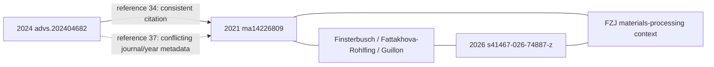

# Bounded experimental-literature pilot

`python -m rhombus.literature.harvest` discovers bibliographic candidates through
Europe PMC, Crossref and OpenAlex, deduplicates normalized DOIs, freezes a
source acquisition list, and retrieves eligible open-access JATS through the
Europe PMC REST service. It is an experimental intake pipeline, not a qualified
production model or an independent scientific benchmark.

## Reproduce and inspect

Run from the existing `/workspace/Rhombus` checkout with its Python 3.11
Fast CI virtual environment active. No API credential or paid service is used.

```bash
python -m pytest -q tests/test_literature_harvest.py
python -m rhombus.literature.harvest \
  --output-dir /tmp/rhombus-discovery-new \
  --discovery-target 1000 --acquisition-limit 100
```

Output directories must be new. This first command records discovery and an
acquisition plan; without a current policy evidence record it does not launch
bulk full-text requests. This is a reproducibility requirement, not an approval
prompt. Inspect the current official documentation, copyright guidance, and
API-host robots policy; retain their local bytes and hashes. A policy JSON binds:

- `provider`: `europepmc`;
- `documentation_url`: `https://europepmc.org/RestfulWebService`;
- `documentation_file`, `documentation_sha256`: retained documentation;
- `verified_utc`: timezone-aware inspection time, no older than seven days;
- `free_fulltext_access_confirmed`: true only after inspecting current terms;
- `max_publications`: internal bound, at most 100;
- `requests_per_second`: at most 0.1;
- `terms_evidence_excerpt`: actual observations, including uncertainties;
- optional `supporting_documents`: objects with `file` and `sha256`.

The validator checks record integrity, freshness and limits. It does not decide
legal terms from a boolean. The inspected 2026-10-20 official copyright page
explicitly permits automated retrieval through REST/OAI/SOAP/bulk services while
prohibiting website crawling. The API host's wildcard robots policy specifies
10 seconds between requests. No numerical provider API quota was stated in the
inspected documentation; 100 is our processing limit, not a provider allowance.
Document-specific licenses remain attached to each authenticated article.

Reuse discovery, rather than repeating valid downloads:

```bash
python -m rhombus.literature.harvest \
  --output-dir /tmp/rhombus-acquisition-new \
  --discovery-file /tmp/rhombus-discovery-new/discovery.json \
  --quota-evidence /path/to/inspected-policy.json --acquisition-limit 100
python -m rhombus.literature.harvest \
  --output-dir /tmp/rhombus-parser-replay-new \
  --replay-acquisition-dir /tmp/rhombus-acquisition-new
```

Replay verifies every retained response against its original retrieval hash and
makes no network requests. Replay is not current source authentication. Raw
full text stays in `raw-local-only` outside the repository; do not add it to Git
without document-specific redistribution authorization. The pilot preserves
bounded JSON reports and row-level derived evidence instead.

## Scientific admission and limitations

Search matches, review screening and oxide-related title prioritization are
metadata heuristics. Discovered DOI count is not relevant original-study count,
independent author-study count, material count or specimen count. Titles never
certify O_ONLY chemistry. A document must match front-matter DOI/PMCID, carry a
document-specific license and identify itself as a research article.

Generic tables retain caption, row and column text and the source hash. Only a
narrow flat schema with explicit sample, nominal formula, route, process
conditions, measured temperature, observable, units and uncertainty is parsed
numerically. Missing context produces EXPLORATORY rows. Strict source-context
qualification requires explicit exact-25 C TOTAL values, lithium/O_ONLY nominal
composition, and complete supported processing context. Sulfur-containing rows
and contradictory condition identities are rejected. Secondary reference-table
markers, repeated identities, spanning columns, scaled/ambiguous units,
inequalities and unspecified room temperature cannot silently qualify.

Existing 2018/2020 source-exact conductivity/process parsers are reused. A new
original-source adapter extracts the seven reported HP/SPS cells in DOI
`10.1002/smll.202506257` (PMC12530038), binding each to Table 3 and its exact
method/temperature column. Units convert mS/cm to S/cm. Pre-press pressure
10 MPa is distinct from processing pressure 25 MPa; 5-minute sintering is
separate from the 850 C, 4-hour post-treatment. The empty SPS 1100 C cell remains
missing. A 25 C water-density statement is not an EIS measurement temperature.
All seven remain EXPLORATORY: conductivity is reported at unspecified RT and
TOTAL/BULK identity is not explicitly qualified.

These parsers do not cover all table layouts, free-text formula/process joins,
PDFs, scanned figures, supplementary tables or uncertainty conventions. Missing
values are never invented. Nominal powder formula is not final pellet chemistry.
DOI is not a guarantee of independent authors, specimens or material families.

The 2026-10-20 run and parser replay are development data. Newly viewed labels
cannot become a blind heldout cohort. No model fitting, benchmark scoring or
OBELiX TEST access occurs here. A future evaluation requires a protocol and
whole connected DOI/composition/specimen/process embargo frozen before label
exposure, plus the existing frozen baselines. This pilot does not claim improved
MAE, ranking, top-1 utility or calibration. P0-01/02/03 stay BLOCKED and production
stays disabled. Checkpoint 0195 is intentionally not consumed by this intake
work while new exact-25 C TOTAL scientific admission remains unresolved.

## Actual pilot result, 2026-10-20

The [bounded evidence report](../data/development/literature_pilot_20261020_v1.json)
retains retrieval hashes, exact failures and derived measurement rows. Discovery
returned **1,000 unique DOI metadata candidates**, including unqualified or
irrelevant hits; it did not prove 1,000 relevant original experimental studies.
The frozen, title-prioritized OA cohort contained **68** publications. All 68
full-text responses were obtained; **63** passed DOI/PMCID, document-license
presence and article-type checks. Two article types were not authenticated as
original research, and three RSC XML sources lacked a document-specific license.
These current intake rejections do not invalidate historical source evidence.

Final local parser replay extracted **12 exploratory manufacturing-condition
rows**: seven new HP/SPS rows from the 2025 Small paper and five previously known
2020 Nb-LLZO rows. **Strict-qualified rows: zero.** It also retained 179 raw table
row candidates. Among all 68 attempts, 47 had no conductivity table candidates,
14 had unsupported extraction schemas, five failed article/rights gates, and two
produced measurement rows. “No table candidates” is a parser coverage outcome,
not proof that an article has no experimental conductivity data.

Discovery used 11 HTTP requests in 26.23 seconds; acquisition used 68 requests
in 672.39 seconds, with a 10-second interval. Final replay used zero network
requests. No paid API calls or additional monetary expenditure were introduced;
CPU time and peak memory were not instrumented. Raw articles remain local.
These are development observations, not independent predictive validation.

The separate source-continuity repair is already on PR #364 at
`cbf37a0d0a93fc2d7ab462d57205e6d360692471`; its complete 0194 workflow
[39378676845](https://github.com/wt2018mask/Rhombus/actions/runs/39378676845)
succeeded. On that exact commit 53/59 latest checks succeeded; five unrelated
SI ZIP/crystal-comparison runs and one OSTI manuscript acquisition failed.
Their failed steps are identified, but full log access is denied in this
cloud environment. Their exact causes remain unresolved; no automatic reruns
or source-validation relaxations were used. Canonical integration remains
blocked and neither existing PR was merged.

## Offline yield review and shared-source repair, 2026-10-20

The [source-by-source review](../data/development/literature_yield_review_20261020_v1.json)
replays the same 68 retained responses and records every DOI, original response
hash, initial loss, review category and inspection evidence. No new paper search
or broad full-text acquisition was performed. These are prioritization judgments
for the current oxide-manufacturing comparison, not declarations that other
studies are scientifically irrelevant.

| Initial loss | Reviewed causes |
| --- | --- |
| 47 without table candidates | 30 outside the target comparison, 5 supplementary-dependent, 6 prose, 2 parser-coverage gaps, 4 scientifically incomparable |
| 14 unsupported schemas | 4 parser gaps, 5 outside the target comparison, 4 scientifically incomparable, 1 supplementary-dependent |
| 5 source-gate rejections | 3 missing document-specific licenses, 2 non-original-study article types |

An additional scoped prose parser recovers six conditions in original DOI
`10.1038/s41467-025-58108-7`, PMC11972412. It binds numerical values to exact
source clauses and paragraph hashes. The 400 C/2 h, 600 C/unspecified hold,
600 C/15 h, conventional reference, pre-densification and post-densification
conditions remain distinct. The unspecified hold is not filled from neighboring
text. The separate 375 MPa hot-press experiment is not attached to these values.

The pre/post-densification pair has the same stated 500 C/2 h crystallization
condition but reported conductivities of 1.8e-4 and 4.2e-7 S/cm. Temperature/time
alone cannot distinguish the two processing orders. This is one author-reported,
previously public comparison; its EIS temperature is not explicitly bound to
that pair and TOTAL/BULK identity remains unresolved. It is not a new exact-25 C
TOTAL benchmark, a causal qualification or evidence of model superiority.

The existing 0190 Sn-garnet parser is reused for eight keyed DS/MS records.
These are already-known 25 C TOTAL source labels, not eight new experiments.
Intake now distinguishes an authenticated article from a failed measurement
parser: a binding failure blocks the labels while preserving article identity.

| Yield | Before | After |
| --- | ---: | ---: |
| Exploratory rows | 12 | 26 |
| DOI groups with extracted rows | 2 | 4 |
| Rows with numeric temperature and hold time | 12 | 17 |
| New strict-qualified DOI groups | 0 | 0 |
| Strict usable manufacturing comparisons | 0 | 0 |

One newly recovered exploratory processing-order comparison is available for
parser/feature development. No model was fitted and exposed labels were not
claimed as an independent evaluation. OBELiX TEST 121 remains unread; P0-01/02/03
remain BLOCKED; scientific GO and production remain OFF. Checkpoint 0195 remains
reserved for substantive qualified scientific progress.

The highest-value supplementary lead is Table 5 of original DOI
`10.1038/s41467-026-74887-z`, PMC13490533, whose own text explicitly reports
25 C TOTAL conductivity for conventional/FAST-SPS samples. After the offline
review, one bounded request for the Europe PMC supplement archive timed out.
A request for its individually linked Supplementary Information PDF was blocked
at the environment proxy for `static-content.springer-cdn.com`. No supplement
bytes were received or source-qualified. The article's CC BY 4.0 notice and
exact linked filename were inspected; no article redistribution was introduced.

The six older source CI failures were all independently confirmed as OSTI 429
in original logs. PR #364 at `03c1bd5b1ba37284d73577c8fd58e4382b0d4251`
passed **59/59 exact-head checks**, including 0153/0156/0162/0163/0164/0165.
The successful 0153 and 0163 logs retained the original manuscript digest; those
runs did not encounter 429. The new 429 handling was exercised by regression
tests, not by manufacturing a rate-limit incident. Neither PR nor main was
merged. See [source recovery](SOURCE_RECOVERY.md) for the repair contract.

## Supplementary Table 5 qualification, 2026-10-20

The [new source and scientific receipt](../data/development/supplementary_table5_74887_20261020_v1.json)
authenticates Yao et al., *Elimination of detrimental grain boundary segregation
in garnets*, Nature Communications, DOI `10.1038/s41467-026-74887-z`,
PMC13490533. Article-specific rights are CC BY 4.0. The retained
[derived cell-coordinate extract](../data/development/table5_74887_bbox_20261020_v1.xml)
is attributed to that source. Raw PDF/ZIP files remain local-only.

The official Europe PMC REST supplementary archive returned HTTP 200 over the
inherited proxy: **51,596,476 bytes**, SHA-256
`9d0965de5b45ae0185046a855fb3774596e670128a9a870c71224032a9fa53ed`.
Its exact JATS-linked `41467_2026_74887_MOESM1_ESM.pdf` member is
**24,795,769 bytes**, SHA-256
`20b2410bb9f2c4188b0f9e8ffe3215a2c27053f7af97151ee64fff687a2d601a`,
46 pages. ZIP CRCs, member bytes, strict PDF objects/content streams, terminal EOF
and SI cover title were checked. The initial heading matcher rejected `Tab.`
after successful download because it expected `Table`; its failure receipt is
preserved. Retained archive bytes were hash-verified and replayed after the
matcher correction, without another network download.

`rhombus.literature.supplement` pins HTTPS resource paths, checks every redirect
before contact, preserves default TLS/proxy trust, streams 64 KiB chunks and
hashes raw bytes. Caps are 40 MiB for this SI PDF and 80 MiB for this official
archive, with at most four redirect-chain requests, 30 s socket timeout and
180 s acquisition deadline checked around reads (a blocked read may last its
remaining socket timeout). ZIP members and expanded sizes are separately
bounded; only the exact SI basename is selected, without extracting paths.
Failed/partial downloads are removed. The generic intake cap stays **8,000,000
bytes**. Source acquisition never authorizes scientific admission.

Reproduce a fresh request into a new local-only directory:

```bash
python -m rhombus.literature.supplement \
  --article-jats /path/to/retained-original-jats \
  --output-dir /tmp/rhombus-table5-new --source archive
python -m pytest -q tests/test_literature_supplement.py tests/test_literature_harvest.py
```

`verify_retained_archive(archive, original_receipt, new_pdf_path)` reproduces the
validated replay; `extract_impedance_cells(pdf_path)` invokes bounded Poppler
extraction from the pinned actual PDF. It compares independently associated
sample/parameter/value/error cells to the visually reviewed source. The saved
bbox is regression evidence, not a replacement for authenticating a PDF.
Poppler is required for this extraction; pinned pypdf is used for PDF integrity.

Pages 37–38 were rendered and directly inspected. Table 5 contains **24 impedance
fit parameters and 24 percentage fit errors**, across S-LLZO (9), SF-LLZO (6),
and annealed SF-LLZO (9). The final R1=35.3, error 13%, on page 37 belongs to the
annealed group continuing on page 38. Assigning it to SF-LLZO would be wrong.
The table prints **no parameter units and no conductivity column**. Its fit
errors are not specimen-level measurement uncertainty. In particular a CPE Q
coefficient with alpha below one is not directly the capacitance quoted in the
article. No resistance inversion, geometry assumption or capacitance substitution
is performed.

All cells retain sample, parameter, value/error strings and PDF coordinates,
plus composition/process and exact-25 C EIS context references. The nominal
Al/Ta powder is Li6.45Al0.05La3Zr1.6Ta0.4O12; it is not the measured final-pellet
formula. S-LLZO was conventionally sintered at 1175 C for 10 h in air. SF-LLZO
uses 53 MPa FAST/SPS in an evacuated graphite die, 45 C/min heating and an
inflection-triggered stop; no fixed peak temperature or dwell is inferred.
The 50 MPa/2 min prepress is a separate step. SI Fig. 4i on page 13 binds the
subsequent anneal to 1000 C/1 h in air; its ramp and cooling remain unknown.
The JATS Fig. 3 caption and electrochemical methods bind EIS to 25 C,
7 MHz–1 Hz, 20 mV, with sputtered Au blocking electrodes. Individual fit-pellet
identities and the relation to the five-pellet statistics remain unresolved.

The article reports 25 C TOTAL conductivity of 1.11 mS/cm (Al/Ta) and 1.55 mS/cm
(Ga). Table 5 cannot independently verify those values: there is no total
conductivity cell or resolved resistance/geometry join. Table 3 is a secondary
literature compilation near RT; Table 7's conductivity is a continuum-model
parameter. Neither is admitted as new measured evidence.

**New strict-qualified DOI groups: 0. New strict original manufacturing-condition
comparisons: 0.** Two original within-study impedance contrasts are described
(S versus SF; SF versus annealed SF), with shared powder and a post-treatment
relationship, not independent materials or heldout experiments. The existing
26 exploratory conductivity rows across four DOI groups stay unchanged.
Publicly exposed labels are development evidence, not blind evaluation.
Scientific GO and production stay OFF; P0-01/02/03 stay BLOCKED; no merge or
checkpoint 0195 is consumed.

The direct Nature/CDN/media candidates returned proxy CONNECT 403 with zero
PDF bytes. The media path was a conventional candidate, not a link recovered
from the inaccessible publisher HTML. Europe PMC access succeeded, so these
publisher denials do not block the completed authentication. Optional direct
publisher access needs exact-host egress for `www.nature.com`,
`media.springernature.com` and `static-content.springer-cdn.com`; the saved cloud
configuration draft includes them but requires review/save/publish to take
effect. No proxy restriction or publisher control was bypassed.

The next scientific action is to inspect the official source-data workbook
(MOESM5, already in the authenticated archive) for explicit EIS units, specimen
geometry, total-conductivity joins and process endpoints. Missing joins must
stay missing; if unresolved, prioritize a new original DOI with an explicit
25 C TOTAL manufacturing-condition table.

## MOESM5 workbook outcome and new source priority

The [MOESM5 scientific receipt](../data/development/moesm5_74887_qualification_20261020_v1.json)
closes the workbook investigation as **INCONCLUSIVE**, with **zero new strict
DOI groups and zero strict original manufacturing-condition comparisons**.
The original 51,596,476-byte ZIP was reused without a network request. Its size,
SHA-256, all-member CRCs and the exact JATS MOESM5 filename/caption were verified.
The selected `41467_2026_74887_MOESM5_ESM.xlsb` is 9,068,841 bytes, SHA-256
`6c084f536b2e02b902319f9570c9a9ffc7c9a40fbbdaa4c9dee3061d6da905f5`.
Both ZIP layers have explicit member/expanded-size bounds. The generic 8 MB
intake limit is unchanged. Raw workbook and archive remain local-only; the
[attributed keyed-cell extract](../data/development/moesm5_74887_cells_20261020_v1.json)
and derived evidence retain original coordinates and units.

All **26 worksheets and 1,699,094 nonempty cells** were scanned. Per-sheet
canonical cell-stream hashes, raw part hashes, exact labels, headers and
annotation positions are retained. No worksheet formula records or comment
parts were found. Six `ExternalData_1` through `_6` defined-name binary
expressions are preserved without execution. Connections/query tables and the
embedded Power Query package were inspected without refresh; they do not provide
a hidden specimen-geometry manifest. pyxlsb 1.0.10 and python-calamine 0.6.1
independently agreed on all cells in the six relevant EIS/DRT/Arrhenius/process/
density sheets, accounting for Calamine's leading-empty-row offset. The other
worksheets contain characterization, simulation, DC polarization or battery
data; their observables are not ionic-conductivity labels.

`Fig 3a EIS` contains measured coordinate pairs: S-LLZO 69, SF-LLZO 57 and
annealed SF-LLZO 69. These **195 points are three traces, not 195 pellets**.
Another 471 fitted pairs are curves, not experimental replicates. Every measured
pair in the receipt retains its original cells, values, units, sample group,
nominal composition, process context, 25 C article-method reference and
unresolved joins. The workbook prints `KΩ`, whereas the article's Fig. 3a axes
print `kΩ cm`. No specimen thickness, electrode area, component-to-total
assignment or link to the Table-5 fit specimen resolves that normalization gap.
Particle diameters, grain widths and processing displacement are not pellet
geometry. Density errors and simulation deviations are not conductivity
repeatability uncertainties.

`Fig3c activation energy` has SF-LLZO versus S-LLZO grain and GB series. Under
the literal `ln[σT (mSK cm-1)]` header, its rounded inverse-temperature coordinate
near 25 C back-transforms to approximately 1.163e-6 S/cm for SF. This disagrees
in scale with the prose's 1.11e-3 S/cm. The conditional calculation is retained
as a diagnostic, not an admitted measurement or a correction from mS to S.
There is no S-LLZO TOTAL series to create a comparable total/total pair.

No missing FAST/SPS peak or hold is inferred from process traces. In particular,
the 1330-valued B column of `FigS3c SPS sintering` is explicitly headed
`pressure (Pa)`; its values are not silently reinterpreted as temperatures.
The existing 26 exploratory conductivity rows remain unchanged. Public/exposed
labels are not blind evaluation. P0 remains BLOCKED, production and scientific
GO remain OFF, and checkpoint 0195 remains unconsumed. Further investigation
of this DOI stops unless a specific new original-source lead appears.

Offline reproduction requires pyxlsb 1.0.10:

```bash
python -m rhombus.literature.workbook \
  --archive /path/to/retained-archive.zip --jats /path/to/retained-original-jats \
  --output-dir /tmp/rhombus-moesm5-new
python -m pytest -q tests/test_literature_workbook.py \
  tests/test_literature_supplement.py tests/test_literature_harvest.py
```

A bounded follow-up used one official Europe PMC metadata query (41 hits) and
two original JATS requests. The highest-priority new source is
**10.3390/ma14226809**, PMC8620275, *Evaluation of Scalable Synthesis Methods for
Aluminum-Substituted Li7La3Zr2O12 Solid Electrolytes*. Its original **Table 4**
explicitly separates TOTAL/bulk/GB conductivity for SSR, SASSR, CP and SD routes;
methods explicitly bind EIS to **25 C** and a common **1200 C / 30 h air** sinter.
This DOI is outside the retained 68-source cohort; global novelty remains to be
audited. No cells from it are admitted yet. The next task is to bind its four
TOTAL cells, uncertainty meaning, full route histories and specimen relationships.
Shared author/lab context must be accounted for; a new DOI is not an independent
lab or blind evaluation. The newly inspected Table-4 labels are now exposed
development data. The other new lead, 10.3390/ma14164737, has explicit 25 C TOTAL
prose/process-time data but no primary conductivity table, so it ranks lower.

## Original Table 4 and source-dependency audit

The [new scientific receipt](../data/development/table4_6809_qualification_20261020_v1.json)
and [attributed source excerpt](../data/development/table4_6809_source_excerpt_20261020_v1.xml)
bind Mann, Küpers, Häuschen, Finsterbusch, Fattakhova-Rohlfing and Guillon,
*Evaluation of Scalable Synthesis Methods for Aluminum-Substituted Li7La3Zr2O12
Solid Electrolytes*, DOI **10.3390/ma14226809**, PMC8620275. Original official
Europe PMC JATS is 116,538 bytes, SHA-256
`0da4f7639daec04bf41c0a96e952a7ec8846eb5034ae531f60694e415d6350c3`.
The document-specific notice explicitly grants CC BY 4.0. Retained original
HTTPS bytes were replayed, not redownloaded; the derived excerpt has its own
hash and cannot authenticate as the raw response.

The narrow `rhombus.literature.table4` adapter authenticates identity, rights,
method paragraphs and keyed Table-4 columns before checking values. It is
registered in the existing literature intake. TOTAL cells are independently
associated with the named routes; Table 5 repeats them and is deduplicated.

| Route | Original Table-4 cell | TOTAL at 25 C, S/cm | Final sintering |
| --- | --- | ---: | --- |
| SSR | R7C2: 3.14(7) | 3.14e-4 | 1200 C, 30 h, air |
| SASSR | R7C3: 2.64(3) | 2.64e-4 | 1200 C, 30 h, air |
| CP | R7C4: 2.02(2) | 2.02e-4 | 1200 C, 30 h, air |
| SD | R7C5: 3.28(3) | 3.28e-4 | 1200 C, 30 h, air |

The source multiplier is 10^-4 S/cm. These are author-calculated TOTAL values
from experimental EIS, not the bulk or capacitance-corrected GB conductivities.
All routes target nominal Li6.4Al0.2La3Zr2O12; nominal equality is not proof of
equal measured final-pellet chemistry. EIS uses Au electrodes, a Swagelok cell,
25 C, 7 MHz–1 Hz and 10 mV/mm. Cold pressing at 120 MPa with a 13 mm mold is
separate from furnace sintering and from the actual polished specimen geometry.

The receipt reconstructs each route with original section hashes. SSR uses
oxide/hydroxide precursors, La2O3 pre-drying at 900 C/10 h, mortar mixing and
20 MPa precursor pressing, then 850 C/20 h and 1000 C/20 h calcinations with
grinding/repressing. SASSR uses nitrate solutions, 150 C evaporation, 95 C/seven
days drying, 800 C/1 h calcination, one-hour mortaring and 1000 C/20 h recalcination.
CP precipitates La/Zr/Al hydroxides at pH 9.5/60 C, filters, dries at 95 C/seven
days, adds LiOH with 10% excess, and calcines at 1000 C/1 h. SD shares the nitrate
solution preparation, sprays into 300 C air and calcines at 1000 C/1 h; it does
not inherit SASSR's subsequent seven-day drying or two calcinations. Common
final preparation uses 7 g powder, 120 MPa pressing, same-powder protection on
MgO, a closed alumina crucible, 5 K/min heating and natural cooling at 5 K/min
or lower. Unspecified dwell/ramp/atmosphere details remain UNKNOWN.

Sintered relative densities are 93.1/86.8/86.8/92.7%. The Table-5 phase-purity
summary has powder-Rietveld context; it is not a final-pellet phase certificate.
The source reports wet-route Li2ZrO3, a final CP tetragonal shoulder and CP Al
deviation. Quantitative final-pellet ICP results are in SI Fig. S2. Two 50 mg
ICP aliquots do not establish independent EIS-pellet replicates.

**Strict decision: zero newly qualified DOI groups and zero strict comparisons.**
Four original point rows and one connected retrospective four-route comparison
are authenticated, and retained as EXPLORATORY. The unchanged generic strict
gate requires a source-supported numeric conductivity uncertainty. Available
JATS does not define the parentheses' numeric scale or statistical meaning;
mentioning large GB calculation errors does not define TOTAL SD/SE/CI.
Parenthetical digits stay literal and numeric uncertainty stays null. This
failure is not caused by shared authors or a new independent-laboratory gate.
The existing 68-source replay stays at 26 rows; these four additional source
rows bring the cumulative development inventory to 30 rows across five DOI
groups. No benchmark labels are admitted as strict observations.

Institutional VOR retrieval at the user-provided Jülich URL and the exact linked
PMC supplemental ZIP returned proxy CONNECT 403. The official Europe PMC
supplement API timed out at 30 s, then returned HTTP 200 but stalled after
65,536 bytes on the bounded retry. The partial ZIP fails integrity and is not
used. Table S1 geometry and any SI uncertainty legend therefore remain unverified.
The generic 8 MB limit and source verification are unchanged. Completing these
checks needs exact-host egress for `juser.fz-juelich.de` and
`pmc.ncbi.nlm.nih.gov`; EBI timeouts are separately recorded transfer failures.
No proxy or publisher restriction was bypassed.

The source-dependency audit checks public front matter and DOI links in 68
retained sources. The 2026 DOI has three exact shared full names and FZJ
affiliations, related solid-state powder processing and different nominal
composition/final sintering. There is no established specimen/batch identity
or numerical reuse linking its experiments to these four rows. Three further
retained DOI identities have author/institution links; bibliographic links do
not merge their measurements or certify experimental independence.



Reference 37 declares the target DOI but renders *Ionics* 2022, 28, 53, rather
than *Materials* 2021, 14, 6809. It is preserved as a malformed bibliographic
link, not verified data lineage. The 2026 investigation stays closed; only its
already authenticated bibliographic/method metadata is used in this audit.

The descriptive order is SD > SSR > SASSR > CP. Uniform choice among the four
reported point values has expected conductivity 2.77e-4 S/cm and top-1 chance
1/4; the observed SD maximum is 3.28e-4 S/cm. The 5.1e-5 difference is a
retrospective oracle-minus-baseline arithmetic contrast, not measured model
gain. SD exceeds SSR by only 1.4e-5 S/cm (about 4.46%); significance and power
are unresolved. All routes have identical nominal composition and final
temperature/hold, so frozen composition-only and 0191 temperature/hold features
cannot rank them. No pre-exposure prediction protocol is attested, no model is
trained and no blind or independent predictive success is claimed. The 0194
hot-press model is outside this furnace-sintering domain.

Industrial cost claims are qualitative: precursor prices, workload and
calcination times differ, while capital equipment, actual energy and solo
route availability are unquantified. SD's pilot spray dryer is not assumed
available. Six pairwise contrasts are not six independent experiments.

Run `python -m pytest -q tests/test_literature_table4.py` for keyed-cell, route,
rights, identity, duplicates and dependency-adversary tests. The single next
source is the original `materials-14-06809-s001.zip`, to review Table S1 and any
explicit uncertainty convention. Checkpoint 0195 remains unconsumed; official
OBELiX TEST 121 remains unread; P0-01/02/03 stay BLOCKED; scientific GO and
production remain OFF. No main merge is performed.
